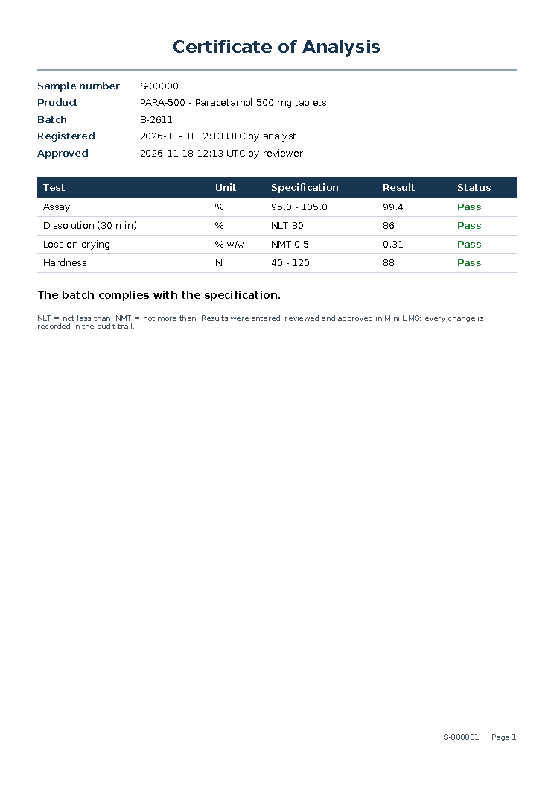
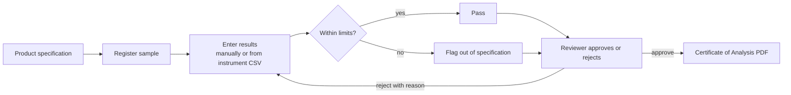

# Mini LIMS

A small laboratory information management system for the sample-to-certificate workflow in a QC lab. Analysts
register samples and enter results, the system checks each result against the product specification, a reviewer
approves the results, and approved samples get a Certificate of Analysis generated with JasperReports. Every change
is recorded in an audit trail that the database itself refuses to edit or delete.

Built with Java 21, Spring Boot, Spring Data JPA (Hibernate), Spring Security, Flyway and JasperReports. It runs on
PostgreSQL or Oracle, signs users in with HTTP Basic or Keycloak (OAuth 2.0), searches samples with Elasticsearch
and ships with Kubernetes manifests.



## Workflow



1. A reviewer defines a product and its specification: each test has a unit and a minimum, a maximum or both.
2. An analyst registers a sample for a batch. The sample gets one pending result per test, with the limits copied
   from the specification, so later changes to a specification never alter past results.
3. Results are entered one by one or imported from an instrument's CSV file. Each result is compared with its limits
   and flagged as out of specification (OOS) automatically. Limits are inclusive.
4. Once every result is in, a reviewer approves or rejects them. A rejection needs a reason and sends the results
   back for correction. Approval locks the results.
5. An approved sample's Certificate of Analysis lists every test, its specification, the result and Pass or OOS,
   and states whether the batch complies. See the [sample certificate](docs/sample-certificate.pdf).

## Data integrity rules

- **Every change is audited.** Registering a sample, entering, changing, importing, rejecting and approving each
  write an audit event with the user, the time, the old and new value, and the reason.
- **Changing a result needs a reason.** The first entry of a result is recorded as "Initial entry"; any later change
  without a reason is refused.
- **The audit trail is append-only.** A PostgreSQL trigger rejects every `UPDATE`, `DELETE` and `TRUNCATE` on the
  audit table, so not even a bug or a manual SQL session can rewrite history. A test proves it.
- **Reviews are independent.** A user who entered or changed any result on a sample cannot review it, even if they
  hold the reviewer role.
- **Approved results are locked.** No result can be entered or changed after approval.
- **Imports never overwrite.** The CSV import only fills empty results; a value that is already entered must be
  corrected by hand, with a reason.

## Instrument CSV import

The file needs a header with `sample_number`, `test_code` and `value`, in any order. Each row is validated on its
own: valid rows are imported, and every rejected row is reported with its line number and the reason.

```
sample_number,test_code,value
S-000001,ASSAY,99.2
S-000001,HARDNESS,abc
S-000099,ASSAY,100.1
```

```json
{
  "imported": 1,
  "errors": [
    {"line": 3, "message": "'abc' is not a number"},
    {"line": 4, "message": "Unknown sample S-000099"}
  ]
}
```

## Search

Every change to a sample (registration, results, review) re-indexes it in Elasticsearch after the transaction commits.
`GET /api/samples/search?q=` runs a simple query over the sample number, product, batch, status and the codes of any
out-of-specification tests, with every word required:

```sh
curl -u analyst:analyst "localhost:8080/api/samples/search?q=paracetamol+DISSOLUTION"
```

Search never blocks the workflow: if Elasticsearch is down, the change is still saved, a warning is logged, and the
search endpoint answers `503`.

## Sign-in: HTTP Basic or Keycloak

The API is an OAuth 2.0 resource server. When a token issuer is configured, it accepts Keycloak access tokens: the
`preferred_username` claim becomes the user recorded in the audit trail and the realm roles `ANALYST` and `REVIEWER`
become the API roles. Docker Compose starts Keycloak with a `lims` realm and the same three demo users:

```sh
TOKEN=$(curl -s -d client_id=lims-api -d grant_type=password -d username=analyst -d password=analyst   localhost:8081/realms/lims/protocol/openid-connect/token | jq -r .access_token)
curl -H "Authorization: Bearer $TOKEN" localhost:8080/api/samples/S-000001
```

HTTP Basic with the demo accounts keeps working alongside it, so the examples below need no token.

## Performance logging

A Spring AOP aspect (`ServiceTiming`) times every call into the workflow service and logs a warning for calls slower
than `lims.slow-call` (500 ms by default).

## API

All endpoints use HTTP Basic authentication. Workflow errors are returned as RFC 9457 problem details.

| Method and path | Role | Purpose |
| --- | --- | --- |
| `POST /api/products` | Reviewer | Create a product with its specification |
| `POST /api/samples` | Analyst | Register a sample for a batch |
| `GET /api/samples/search?q=` | Any | Search samples in Elasticsearch |
| `GET /api/samples/{number}` | Any | Sample with its results and OOS flags |
| `PUT /api/samples/{number}/results/{testCode}` | Analyst | Enter or change a result (`value`, `reason`) |
| `POST /api/results/import` | Analyst | Import instrument results from a CSV file |
| `POST /api/samples/{number}/review` | Reviewer | Approve or reject the results (`decision`, `reason`) |
| `GET /api/samples/{number}/audit` | Any | Audit trail of the sample |
| `GET /api/samples/{number}/certificate` | Any | Certificate of Analysis PDF (approved samples only) |
| `GET /actuator/health/readiness`, `/liveness` | Public | Kubernetes probes |

The demo accounts are `analyst`, `reviewer` and `lead` (analyst and reviewer), each with its name as the password.
They are defined in `application.yml` for HTTP Basic and in `keycloak/lims-realm.json` for Keycloak.

## Run it

Requires Docker.

```sh
docker compose up --build app
```

This starts PostgreSQL, Elasticsearch and Keycloak (on port 8081) with the app.

Then walk through the workflow with the sample files:

```sh
curl -u reviewer:reviewer -H "Content-Type: application/json" -d @samples/product.json localhost:8080/api/products
curl -u analyst:analyst -H "Content-Type: application/json" \
     -d '{"productCode":"PARA-500","batchNumber":"B-2611"}' localhost:8080/api/samples
curl -u analyst:analyst -F file=@samples/instrument-results.csv localhost:8080/api/results/import
curl -u analyst:analyst -X PUT -H "Content-Type: application/json" \
     -d '{"value":88}' localhost:8080/api/samples/S-000001/results/HARDNESS
curl -u reviewer:reviewer -H "Content-Type: application/json" \
     -d '{"decision":"APPROVE"}' localhost:8080/api/samples/S-000001/review
curl -u reviewer:reviewer localhost:8080/api/samples/S-000001/audit
curl -u analyst:analyst localhost:8080/api/samples/S-000001/certificate -o certificate.pdf
```

## Kubernetes

`k8s/` deploys the app (two replicas with readiness and liveness probes) and PostgreSQL (a StatefulSet with a
persistent volume). The container runs as a non-root user with no extra privileges, which also suits OpenShift's
restricted security policy.

```sh
docker build -t mini-lims:1.0.0 .
kubectl apply -k k8s
kubectl port-forward service/mini-lims 8080:8080
```

Change the database password in `k8s/postgres.yaml` first. Search and Keycloak are optional and not part of the
manifests; point `SPRING_ELASTICSEARCH_URIS` and the `SPRING_SECURITY_OAUTH2_RESOURCESERVER_JWT_*` variables at your
own services to enable them.

## Oracle

The same code runs on Oracle Database. Flyway picks the migrations for the connected database from
`db/migration/{vendor}`, so PostgreSQL and Oracle each have their own schema script, including the append-only audit
triggers. Point the datasource at Oracle to use it:

```sh
SPRING_DATASOURCE_URL=jdbc:oracle:thin:@//host:1521/FREEPDB1
```

## Tests

The tests run the real application against PostgreSQL 17 and cover OOS flagging at the limits, reasons for changes,
the audit trail and its trigger, independent review, rejection, row-level CSV validation, role checks and the
content of the generated certificate:

```sh
docker compose run --rm tests                            # PostgreSQL
docker compose --profile oracle run --rm tests-oracle    # Oracle Database 23ai
```

CI runs both on every push.

## Repository

| Path | Contents |
| --- | --- |
| `src/main/java/minilims/LabService.java` | Workflow rules: registration, results, OOS, import, review, audit |
| `src/main/java/minilims/CoaReport.java` | Fills and exports the Certificate of Analysis |
| `src/main/java/minilims/SampleSearch.java` | Elasticsearch indexing after commit, and search |
| `src/main/java/minilims/SecurityConfig.java` | HTTP Basic, Keycloak tokens and role mapping |
| `src/main/java/minilims/ServiceTiming.java` | AOP aspect that logs slow service calls |
| `src/main/resources/reports/coa.jrxml` | JasperReports template, editable in Jaspersoft Studio |
| `src/main/resources/db/migration/` | Flyway schemas for PostgreSQL and Oracle, with the audit triggers |
| `k8s/` | Kubernetes manifests |
| `keycloak/lims-realm.json` | Keycloak realm with roles and demo users |
| `src/test/java/minilims/LabWorkflowTest.java` | End-to-end tests against PostgreSQL |
| `samples/` | Demo product specification and instrument CSV file |

## Known limits

- One sample per batch and one result per test; replicates and retests would need a result history per test.
- The CSV parser splits on commas and does not handle quoted fields, which instrument exports rarely use.
- Electronic signatures (re-entering a password to approve) are not implemented.
- Values are stored as numbers, so trailing zeros are not kept (98.0 is shown as 98) on either database. A full LIMS
  would store a reporting precision for each test.
- The search index is updated after each commit; if Elasticsearch was down at that moment, the sample is re-indexed on
  its next change.
